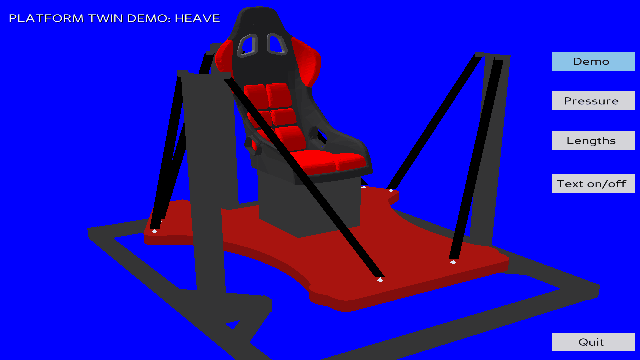

# MDX Platform Twin

A lightweight, standalone **Panda3D visualizer** for the Middlesex University suspended six-degree-of-freedom Stewart motion platforms. It shows the platform, pneumatic actuators and a simplified payload, and can operate as an animated demonstration or follow motion data received over UDP.



> This 12-second `platform_v2` preview was generated using the optional Panda3D capture utility below. For a different selected platform, update the image link to the corresponding `demo-<platform>.gif`.

## Features

- **Demo:** animated motion without a network source.
- **Twin (UDP):** reconstruct the platform pose from six commanded muscle lengths or estimate it from commanded pressures using an empirical pressure model.
- **EasyIP (UDP):** receive Festo-style pressure commands directly for a pressure-driven visualization.
- **Pose-difference overlay:** optionally show the outline of POC's applied real-world transform alongside the modelled platform pose. Available with compatible Twin packets only while POC reports the platform **UNPARKED**.
- **Touchscreen-friendly controls:** on-screen mode, diagnostics, Pose Diff and quit buttons; swipe to adjust the camera, or use keyboard controls.
- **Two bundled platform profiles:** `platform_v2` and `chair_v2`, with platform geometry and POC kinematics included for standalone use.

**Scope:** This is a visualization and modelling tool, not a physical platform controller. Pressure-derived pose is an estimate, not a measurement of real platform motion.

## Installation

1. Download or clone this repository and keep the directory structure, including `assets/`, `platforms/`, `pressure_data/` and `bundled_poc/`.
2. Use Python 3 with the dependencies in `requirements.txt`:

   ```bash
   python -m pip install -r requirements.txt
   ```

3. Start the visualizer:

   ```bash
   python platform_visualizer.py
   ```

The program runs on Windows and Linux, including Raspberry Pi OS. Rendering speed depends on the hardware and the chosen input mode. On Raspberry Pi OS, install the project into an appropriate Python environment if system-managed Python prevents direct `pip` installation.

At startup, choose **Twin** or **EasyIP** if `input_mode` is not set in `app_config.json`. The current available IPv4 listening addresses are shown in the selector; the visualizer does not change network configuration. Demo mode is available after the receiver is selected.

## Capture a demo GIF (optional)

The standalone `tools/capture_demo_gif.py` utility captures the full **12-second**
Demo animation directly from Panda3D, keeping the touchscreen buttons and only
the `PLATFORM TWIN DEMO: <DOF>` heading (other text is hidden).
Each of the six axes runs for 2 seconds, using the active platform's
`LIMITS_1DOF_TRANFORM` from its POC kinematics configuration (translations in
mm, rotations in radians). The capture uses fixed simulated timestamps, so the
resulting GIF speed does not depend on rendering speed.

Install Pillow in the same environment as Panda3D (`python -m pip install Pillow`),
then run from the repository root:

```bash
python tools/capture_demo_gif.py
python tools/capture_demo_gif.py --fps 8
```

The default output is `docs/demo-<selected_platform>.gif` (for example,
`docs/demo-chair_v2.gif` or `docs/demo-platform_v2.gif`), 640 x 360,
12 fps, continuously looping. The platform comes from `selected_platform` in
`app_config.json`. Adjust the README image link above to match the GIF you generate.
Edit **`FPS = 12`** near the top of the script or pass `--fps` to try smaller
values; `--width`, `--height`, `--output` and `--poc-root` are also available.
This utility opens its own temporary rendering window; it does not modify the
visualizer's normal settings, bind UDP sockets, or require changes to the
application's startup mode. GIF capture is optional and is not run on startup.

## Input modes

| Source | UDP port (default) | What is visualized |
| --- | --- | --- |
| Demo | No packets needed | Built-in animated motion sequence |
| Twin / Lengths | `10020` | Forward-kinematics pose from POC muscle-length data |
| Twin / Pressure | `10020` | Estimated pose based on POC pressure commands and the pressure model |
| EasyIP / Pressure | `995` | Estimated pose based on incoming EasyIP pressure commands |

The Twin receiver accepts compatible POC digital-twin datagrams. The Pose Diff overlay requires the extended packet fields `applied_transform_real` and `parking_state` from a compatible POC release. It is deliberately hidden while parked and when the input is stale. The EasyIP receiver is **receive-only**; it does not acknowledge packets or control hardware.

On Linux, binding to UDP port `995` may require a system permission change. See the version-specific setup notes if an EasyIP bind reports `PermissionError`.

## Controls

| Control | Action |
| --- | --- |
| Demo / **T** | Built-in animation |
| Pressure / **F** | Pressure-driven model |
| Lengths / **L** | Muscle-length model (Twin only) |
| Pose Diff button | Toggle commanded-pose outline (Twin only) |
| Text on/off / **H** | Show or hide diagnostic text |
| **F1** | Show or hide keyboard help |
| Arrow keys or **W/A/S/D** | Orbit horizontally; orbit vertically through top/bottom views |
| Horizontal / vertical swipe | One matching arrow-key camera step |
| **+ / -** | Zoom camera (film size in orthographic mode) |
| **O** | Toggle perspective / orthographic projection |
| **1 / 2 / 3** | Snap to top (+Z), front (+X), or side (-Y) views; preserve zoom and projection |
| **Page Up / Page Down** | Move camera view target vertically |
| **C / Home** | Restore starting camera and perspective projection |
| **N** | Toggle actuator labels |
| **Ctrl + / - / 0** | Enlarge, shrink or reset window size |
| Quit / **Q / Esc** | Exit |

Camera motion does not reposition the on-screen buttons.

## Configuration

Edit `app_config.json` to choose the platform, display options, network ports and pressure-model settings. Relevant optional keys include:

```json
{
  "selected_platform": "platform_v2",
  "input_mode": "twin"
}
```

The snippet illustrates **keys**, not a replacement for the complete configuration file. Valid platforms include `platform_v2` and `chair_v2`; set `input_mode` to `twin` or `easyip`, or omit it to select at startup.

By default the visualizer uses its own `bundled_poc/` configuration and kinematics. To use the files from an existing POC checkout, set `poc_root` in `app_config.json` or pass a command-line override:

```bash
python platform_visualizer.py --poc-root /path/to/POC
```

The command-line path takes priority. An invalid explicit path fails clearly rather than falling back silently. For an external root, the visualizer reports only bundled/external files whose **contents differ**, with their modification times; identical files produce no comparison output.

To force a display mode for testing:

```bash
python platform_visualizer.py --fullscreen
python platform_visualizer.py --windowed
```

## Repository layout

| Path | Purpose |
| --- | --- |
| `platform_visualizer.py` | Application, camera, rendering and motion-mode orchestration |
| `demo_motion.py` | Platform-limited six-axis 12-second canned motion |
| `tools/capture_demo_gif.py` | Optional reproducible Panda3D-to-GIF utility (requires Pillow) |
| `visualizer_ui.py` | Touch controls, input chooser and status/help display |
| `poc_platform.py` | Platform configuration/kinematics adapter |
| `bundled_poc/` | Minimal bundled POC platform configuration and kinematics |
| `platforms/`, `assets/` | Platform profiles and geometry assets |
| `pressure_data/`, `pressure_model.py` | Empirical pressure-to-length model |
| `twin_udp.py`, `easyip_receiver.py` | Receive-only UDP inputs |
| `tests/` | Automated tests |

## Diagnostics and limitations

### Platform-specific chair and support

Each `platform_profiles` entry may override `chair.model`, `chair.enabled`, offsets, and individual values in `chair.support`. Nested support overrides inherit global `chair.support` width, depth and colour. Currently `platform_v2` uses the bundled `assets/seat_lowpoly.egg` with a **300 mm** support; `chair_v2` uses the same model with a **250 mm** support. The model path can be changed independently for either platform when a suitable compatible asset is available.

Set `chair.support.height_mm` to `0` to omit the support block and place the seat directly at deck height; negative heights are invalid. A model should have its bottom at local Z=0 to rest correctly; `chair.z_offset_mm` (default 0) allows adjustment for models with different origins. This is visual geometry only and does not change the kinematics, load or control. An optional wheelchair model is **not bundled**.

Lengths mode is useful for validating that the command geometry and forward kinematics agree. Pressure mode additionally models actuator response and can diverge from the commanded transform. Neither is a direct measurement of actual muscle lengths or platform position.

The on-screen Pose Diff outline compares POC's **applied real transform** with the calculated or estimated pose, but only for valid, unparked Twin input. Geometry consistency warnings and UDP reception diagnostics support development and testing.

For historical implementation and configuration details, see the `README_v*.txt` release notes and the project handover document.

Camera elevation is clamped to -90° (bottom) through +90° (top). Press **O** to toggle orthographic view; zoom in this mode changes the orthographic film size. **Home** restores the original view and perspective projection.

Camera snap views use the platform world axes: **front** is viewed from positive X toward the origin; **side** from negative Y with positive X to the right; **top** from positive Z with positive X to the right. Snap views preserve zoom and projection mode.
