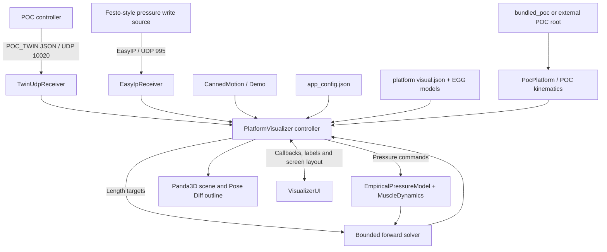

# MDX Platform Twin - Architecture and Maintainer Guide

**Code baseline:** MDX Platform Twin v56 (October 2026)  
**Audience:** maintainers, contributors and Engineering students  
**Related documents:** [Project Ideas.md](Project%20Ideas.md), [repository README](../README.md), [Platform instrumentation](PLATFORM_INSTRUMENTATION_v1.md) (research handover)

> This describes the existing implementation. Paths and names refer to the v56 repository. Consult the code and tests when changing behaviour, especially if POC and the Twin are developed independently.

## 1. Purpose and boundaries

MDX Platform Twin is a **receive-only, Panda3D-based visualizer** for Middlesex University's suspended six-degree-of-freedom Stewart platforms. Six pneumatic muscles support the moving structure from above. The application can show a built-in motion demonstration, reconstruct a pose from six *commanded* muscle lengths, or estimate a pose from six *commanded* muscle pressures.

The distinction matters:

- **POC (Platform Operators Console)** processes simulator motion, applies kinematics and issues platform commands.
- **The Twin** receives a copy of those commands, solves for a visual pose and renders the result.
- **Physical motion is not measured by the Twin.** The pressure model is predictive; it does not read measured actuator lengths, pressures or physical pose.
- The Twin does **not** transmit Festo commands, acknowledge EasyIP datagrams or control the physical platform.

Two packaged platform selections are `platform_v2` (MDX suspended platform) and `chair_v2` (suspended chair). Their geometry and visuals are different, while the receiving, modelling and display architecture is shared.

## 2. System at a glance



The diagram reflects logical data flow. The receiver objects run background UDP threads; the controller pulls their **latest** snapshots in the Panda3D update task. The interface does not queue every received packet for animation.

## 3. Source-code map

| File or directory | Current responsibility | Change here when... |
| --- | --- | --- |
| `platform_visualizer.py` | `PlatformVisualizer(ShowBase)`: startup, input/mode state, 3D scene, camera, update loop, rendering and Pose Diff outline | Changing orchestration, scene assembly or runtime behaviour |
| `visualizer_ui.py` | Panda3D DirectGUI input chooser, fixed-position touch buttons, text/help overlay and swipe interpretation | Changing screen layout, buttons or interaction |
| `poc_platform.py` | Loads the selected POC config/kinematics; exposes attachment points, pose transforms and accepted platform IDs | Updating the POC adapter or bundled/external root handling |
| `forward_solver.py` | Bounded iterative solution of six-DOF pose from six muscle lengths | Investigating numerical convergence and geometry consistency |
| `pressure_model.py` | Empirical pressure-to-contraction interpolation, rising/falling behaviour and contraction/extension slew limits | Researching actuator response or pressure-model improvements |
| `twin_udp.py` | Receives, validates and stores newest `POC_TWIN` JSON packet | Extending the Twin receive protocol |
| `easyip_receiver.py` | Read-only decoder for six/seven-word EasyIP pressure-write datagrams | Supporting additional documented EasyIP input variants |
| `udp_diagnostics.py` | Sequence, timing and packet-skip statistics | Diagnosing source/network/rendering timing |
| `demo_motion.py` | Twelve-second, six-stage motion using active POC kinematic DOF limits, without incoming commands | Changing the demonstration sequence |
| `visual_geometry.py` | Loads and validates compiled visual geometry JSON | Supporting new geometry formats |
| `platforms/`, `assets/` | Source/compiled geometry, outlines and optional Panda3D EGG meshes | Updating platform appearance or CAD-derived geometry |
| `bundled_poc/` | Minimal POC platform registry, configuration and kinematics needed to run standalone | Refreshing the shipped POC-derived baseline |
| `pressure_data/` | Recorded pressure-to-contraction curves by load | Introducing or calibrating empirical datasets |
| `tests/` | Automated regressions for geometry, receivers, UI, solver and newer features | Any code change; add a matching focused test |
| `tools/` | Offline geometry build, diagnostics and `capture_demo_gif.py` | Regenerating derived geometry or investigating models |
| `pi/` | Raspberry Pi setup and launcher scripts | Pi-specific deployment changes |

**Architectural boundary:** `visualizer_ui.py` receives screen-space Panda3D anchors and callback functions from the controller. It should not own a duplicate of the platform pose, simulate pressures or build the physical scene. The controller owns runtime state and updates the UI.

### Possible later renderer extraction

`platform_visualizer.py` is still the largest module: it contains camera and scene-building code alongside the update loop. If rendering expands substantially, a `visualizer_scene.py` module could own scene nodes and their update functions. Keep this as a **future option**, not a prerequisite for normal contributions. Avoid adding a general event framework or another UI toolkit just to separate these responsibilities.

## 4. Startup, configuration and platform geometry

### Launch and selection

```bash
python platform_visualizer.py
python platform_visualizer.py --poc-root /path/to/POC
python platform_visualizer.py --fullscreen
```

`app_config.json` contains display/camera settings, a selected platform, per-platform visual overrides, UDP ports, stale timeout, solver options and empirical-model parameters. The user selects **Twin** or **EasyIP** on startup if `input_mode` is absent or invalid; otherwise the configured receiver is used. Demo remains available once a receiver has been selected.

For platform/kinematics files the priority is:

1. Valid explicit `--poc-root PATH`.
2. Valid `poc_root` in `app_config.json` (relative paths resolve from the visualizer directory).
3. Local `bundled_poc/` (the default standalone choice).

An explicitly selected but invalid root **fails clearly** rather than silently falling back. With an external root, `poc_platform.py` compares the relevant files to the bundle using 8 KB binary chunks. Only differing/missing files are reported; different timestamps alone do not trigger output. Reported mismatches are informational, and the selected external files remain authoritative for that run.

`PocPlatform` imports the POC platform registry and `kinematics/kinematics_V3.py`, constructs the selected config class, and exposes fixed and moving attachment coordinates, muscle length parameters, reference height and motion bounds. **Kinematics and visual models must use the same platform geometry.**

### Geometry artifacts and coordinate conventions

- `platforms/<profile>/source.json` captures CAD-derived geometry information.
- `platforms/<profile>/visual.json` provides compiled outlines, fixed-frame lines, attachments and upright descriptions for the renderer.
- `assets/*.egg` contains optional fixed/moving platform and seat/chair meshes.
- `visual_geometry.py` validates compiled files. Startup checks attachment coordinates against POC-derived kinematics; mismatches can stop startup. A source-file SHA-256 check warns if visual JSON has become stale relative to its input source.

**Units and poses:** POC and the Twin use six-element real pose vectors in the order `[x, y, z, roll, pitch, yaw]`; translations are in **millimetres** and angles are in **radians**. POC `transform` in the UDP packet is **normalized**, not a real-world pose. When available, `applied_transform_real` is the authoritative applied real transform for the Pose Diff overlay. Coordinate orientation and sign adjustments belong in the POC kinematics/geometry adapter, not ad-hoc rendering offsets.

Chair support and seat configuration can be overridden under `platform_profiles.<platform>.chair`; `platform_v2` uses a 300 mm support and `chair_v2` uses 250 mm. Both currently select `assets/seat_lowpoly.egg`; zero support height hides the block, and a different model can be selected per profile. The common support colour is dark grey, `[0.17, 0.17, 0.17, 1.0]`.

The MDX (`platform_v2`) CAD **parked pose** is outside the normal active-motion bounds; it has a special CAD-derived parked transform. The chair variant retains the earlier constrained full-extension estimate. In the MDX rendering, the moving deck is drawn below the attachment reference and six simplified 17 mm clevis pyramids mark attachment centroids; small pads accommodate differences in CAD joint heights. These are **visual geometry**, not modified muscle endpoints.

When updating CAD or platform configs: regenerate relevant visual files, validate fixed/moving attachment coordinates, check both active and parked poses, and test the Pose Diff overlay against compatible POC input. Do not repair a coordinate mismatch by arbitrarily shifting camera or muscle endpoints.

## 5. Input protocols and processing

### Twin input (UDP, default port 10020)

`TwinUdpReceiver` binds IPv4 `0.0.0.0`, accepts the `POC_TWIN` protocol version **1**, checks six finite `muscle_length_mm` values and six finite `command_pressure_mbar` values, and retains the newest valid packet. It also supports the optional v150-era fields:

| Packet item | Meaning |
| --- | --- |
| `platform` | Platform identity, checked against the selected profile |
| `sequence`, `timestamp_ms` | Source ordering/timing information for diagnostics |
| `transform` | Processed **normalized** transform, not real mm/radians |
| `muscle_length_mm` | Six POC commanded muscle lengths |
| `command_pressure_mbar` | Six POC commanded pressures, in millibar |
| `applied_transform_real` | Optional applied six-DOF real transform in mm/radians |
| `parking_state` | Optional `PARKED`, `PARKING`, `UNPARKING` or `UNPARKED` |

Other metadata such as load and platform/simulator states may be present in packets. Consult `twin_udp.py` and the POC sender for the exact wire contract. UDP is unacknowledged and can be lost or reordered. Protocol acceptance does not establish accurate physical motion.

### Direct EasyIP input (UDP, default port 995)

`EasyIpReceiver` decodes the existing POC/Festo-style EasyIP pressure write: six 16-bit pressure words, with an optional seventh **prop command** word (`0` engage, `1` disengage). It does **not** provide POC transforms or platform parking state, and does **not** send acknowledgements. The prop value is a command, not a sensor reading. Lengths mode and the Twin Pose Diff are not available with EasyIP-only input.

Binding to port 995 may require appropriate Linux network permissions. The visualizer reports available IPv4 interfaces at selection time but never modifies IP addresses.

### Visual modes

| Mode | Pipeline | What it establishes |
| --- | --- | --- |
| **Demo** | `CannedMotion` -> pose -> scene | Demonstration animation, no platform measurement |
| **Twin / Lengths** | Twin commanded lengths -> bounded forward solver -> scene | Consistency between POC lengths, geometry and reconstructed pose |
| **Twin / Pressure** | Twin pressure commands -> empirical contraction -> slew -> muscle lengths -> forward solver -> scene | **Estimated** dynamic response, dependent on model parameters |
| **EasyIP / Pressure** | Direct EasyIP pressure writes -> same pressure pipeline -> scene | Estimated pose using configured platform/profile, with no Twin comparison transform |

`EmpiricalPressureModel` uses the recorded `pressure_data/PtoD_40.csv` and `PtoD_80.csv` load curves (unless configured otherwise), distinct rising/falling branches and pressure interpolation. The **current implementation uses the configured `pressure_model.empirical_load`** when estimating contraction; do not assume it automatically uses the latest Twin packet's load. `MuscleDynamics` then limits contraction/extension rates separately (default 100 mm/s each). These defaults are empirical assumptions, not validated measurements of physical response.

The forward solver uses NumPy and POC inverse kinematics inside a bounded iterative fit. It reports RMS muscle-length residual; a non-zero residual means the pose did not reproduce the target lengths exactly. It is not a general-purpose physics simulation of pneumatics, flexible structures or loads.

### Update loop and packet handling

- The Panda3D task loop targets the configured `update_hz` (default 20 Hz).
- UDP reception runs in a background thread and exposes an atomic latest-packet snapshot.
- Calculations run when the packet count advances; old snapshots may be skipped, by design.
- EasyIP forward solves can be rate-limited (default 10 Hz, maximum eight solver iterations) for Pi performance; Twin processing follows new valid packet arrivals.
- The moving geometry is not rebuilt when the pose is unchanged. UI uses screen-space anchors, so camera orbit/zoom does not move the buttons.
- A stale timeout (default 0.5 s) updates the status; Pose Diff is hidden when data is stale. Do not interpret the last drawn physical-looking platform as a new measurement.
- Switching from Demo into a live mode first displays the computed parked position and waits for **a fresh accepted packet**, ignoring packets buffered during Demo.

`PacketDiagnostics` distinguishes *received but superseded* packets from possible upstream sequence gaps and tracks packet timing. The timing output is useful for deciding whether a pressure-model discrepancy reflects the model or the processing cadence.

## 6. Pose Diff overlay

The optional cyan outline shows **POC's applied real transform**, while the solid moving platform uses pose reconstructed from commanded lengths or pressures. The outline contains no chair, muscle lines or clevis markers.

It is rendered only if all of the following hold:

- The user enabled **Pose Diff**.
- Input source is Twin and an accepted, fresh packet exists.
- The packet includes a valid six-element `applied_transform_real`.
- `parking_state` is explicitly **`UNPARKED`**.

It disappears in Demo, EasyIP, stale/waiting states and parking transitions. Older Twin packets still drive the solid platform but have no Pose Diff overlay. Diagnostic XYZ and RPY differences compare **two calculated/commanded quantities**; they are not a platform tracking-error measurement until independent sensors are added.

## 7. Display and interaction

`VisualizerUI` owns the startup chooser, status/help text and DirectGUI buttons anchored at the right side of the screen. It also interprets touch/mouse press-release gestures in the scene area as **one** arrow-equivalent camera increment; taps and ambiguous diagonals are ignored. The controller retains key bindings, camera parameters, pose and mode transitions.

The `H` key hides routine diagnostic text but leaves errors visible. `O` toggles perspective/orthographic projection; `1`, `2`, `3` snap to top (+Z, +X to screen right), front (+X) and side (-Y, +X to screen right) respectively. Arrow keys orbit through top and bottom views; `Home` resets the camera and perspective. The zoom keys adjust orthographic film size rather than camera distance in ortho mode. A fullscreen 800 x 480 setup starts with a camera radius equivalent to five additional zoom-out increments; windowed behaviour is unchanged. Do not add screen widgets to the 3D `render` scene: they should remain fixed during camera movements.

### Reproducible Demo GIF

`CannedMotion` takes the six amplitudes from `PocPlatform` (`LIMITS_1DOF_TRANFORM`), with 2 seconds per DOF and a 12-second loop. The standalone `tools/capture_demo_gif.py` renders directly from Panda3D at fixed simulation timestamps, retains on-screen buttons and the `PLATFORM TWIN DEMO: <DOF>` heading, and hides other diagnostics. The default `FPS = 12` can be changed or overridden with `--fps`; the default filename is `docs/demo-<selected_platform>.gif`. Pillow is required only for generating GIFs, not ordinary runtime use.

## 8. Tests and safe extension workflow

Install requirements and run the existing tests:

```bash
python -m pip install -r requirements.txt
python -m pytest tests
python -m py_compile platform_visualizer.py visualizer_ui.py poc_platform.py
```

The codebase tests geometry and parked transforms, receivers, pressure modelling, UI callbacks and gesture decisions, Twin Pose Diff rules, and standalone/external POC support. Tests are **not a substitute** for a live Panda3D run on Windows and on the target Raspberry Pi.

Recommended change sequence:

1. **Define the observable:** identify whether a number is a command, a model estimate or a physical measurement; decide its units and coordinate frame.
2. **Keep boundaries:** UI in `visualizer_ui.py`, packet validation in receivers, modelling in `pressure_model.py` / `forward_solver.py`, orchestration/rendering in `platform_visualizer.py`.
3. **Make a narrow change:** avoid altering POC geometry, normalization or platform limits simply to improve visual appearance.
4. **Write focused tests:** include invalid input, timing edge cases, parked/stale mode changes and both platform profiles where relevant.
5. **Validate dynamically:** compare Demo, Twin/Lengths, Twin/Pressure and EasyIP paths; check responsiveness on the Pi.
6. **Document provenance:** record test conditions, POC/visualizer revisions, model settings and any changes to generated geometry or pressure curves.

When contributing geometry, update its source and regenerate/verify compiled outputs rather than editing one side of a validated pair. When extending the Twin protocol, add optional fields where possible and preserve old packet acceptance unless there is a deliberate version change. Avoid introducing actuator commands, automatic control or physical safety assumptions into this visualization application.

## 9. Current limitations and useful next steps

- No physical position, actuator length or pressure feedback is captured by the Twin.
- The empirical pressure model cannot yet be treated as a validated dynamic model across all loads, pressures and operating conditions.
- The pressure calculation uses a configured model load; a future project could evaluate safe use of the transmitted load metadata.
- Snapshot processing intentionally discards intermediate UDP packets under load; this is fine for live presentation, but not for high-integrity data acquisition.
- Bundled POC code and platform data are **copies**, not a shared runtime package. Explicit external-root comparison helps reveal divergence but does not resolve it automatically.
- The renderer, scene and camera remain in one relatively large controller class; scene extraction is optional if later work makes it worthwhile.
- Numerical agreement in Twin/Lengths mode validates internal consistency, **not** physical accuracy.

For measurement-based extensions, start with the accompanying [Project Ideas](Project%20Ideas.md) document and the instrumentation doc. The preferred first experiment in that doc is a calibrated fixed camera observing a rigid AprilTag board, with synchronized POC commands and measured pose. All initial instrumentation must be **observation-only** and subject to the platform's normal operating and safety procedures.
